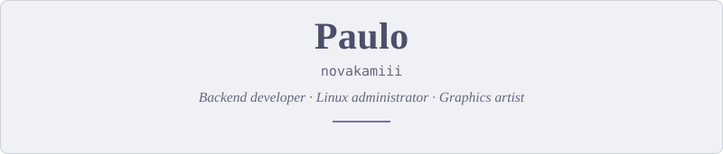
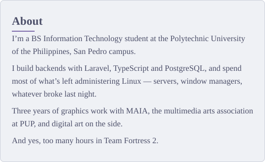
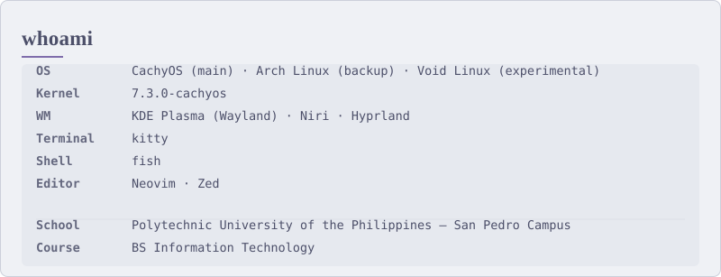
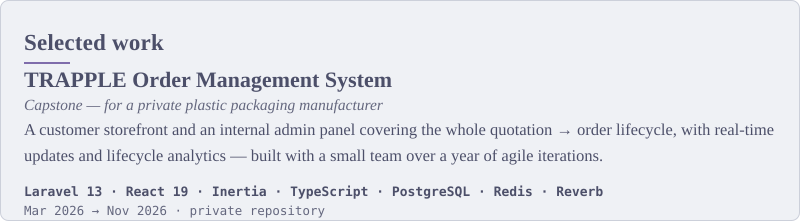
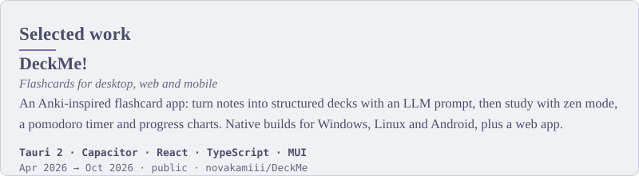
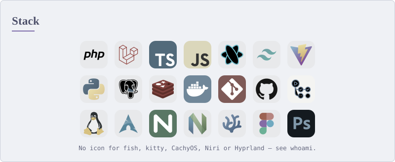
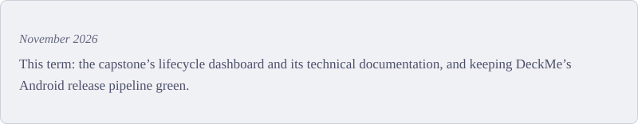
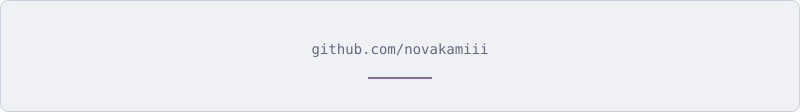
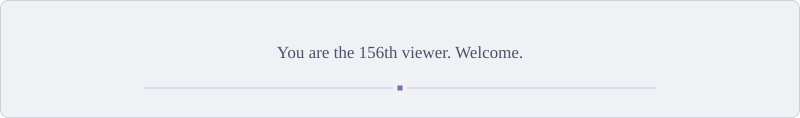

<!-- 1px counter pixel: the only source of the view count. It increments the
     badge service; scripts/update_views.py bakes that number into the plain-text
     views card above nightly. -->

